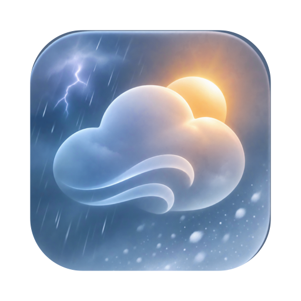
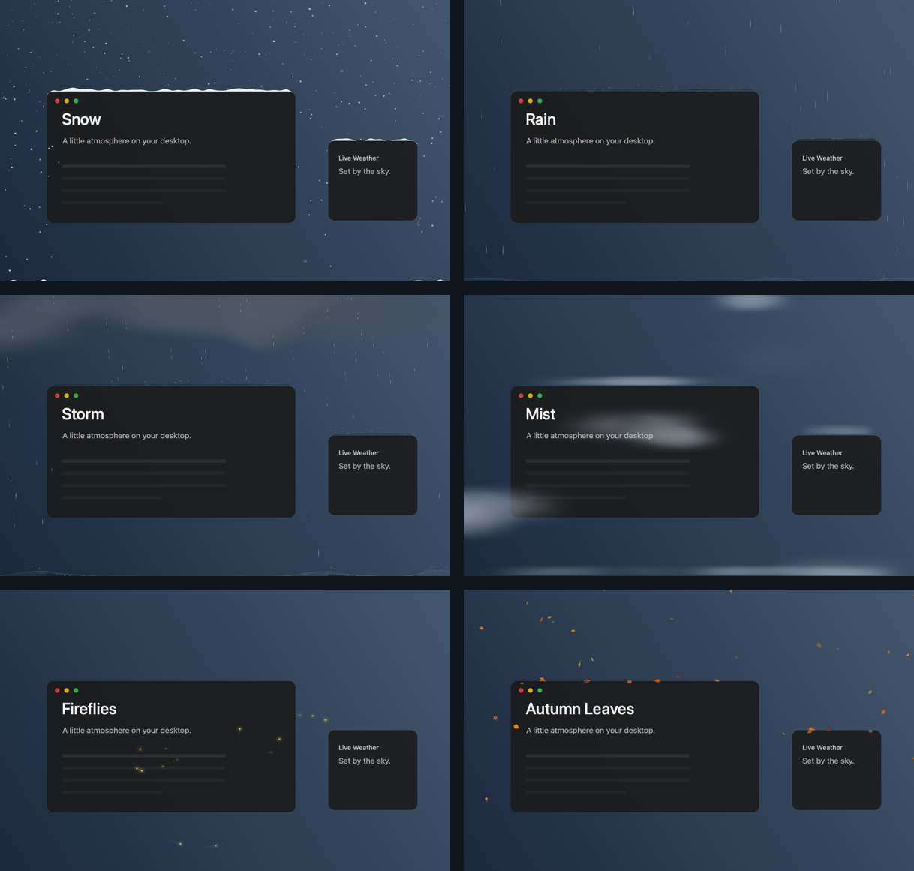
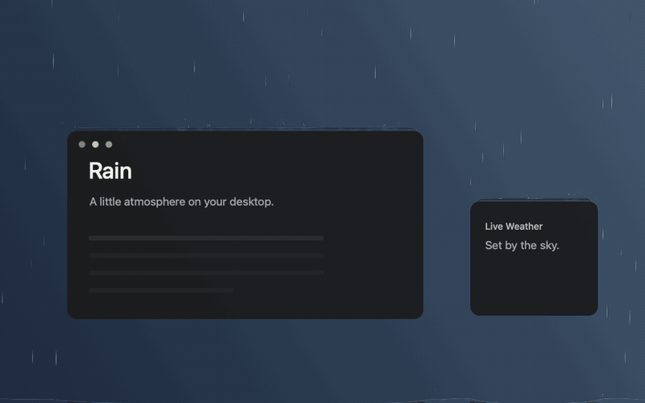

<p align="center">
  
</p>
<h1 align="center">Atmos</h1>
<p align="center">A little atmosphere on your desktop.</p>
<p align="center">
  <a href="https://grobb.dev/projects/atmos">Download for Mac</a> ·
  <a href="https://github.com/scott-g-robb/Atmos/releases">GitHub Releases</a> ·
  <a href="#try-it">See it in motion</a> ·
  <a href="#build">Build from source</a>
</p>
<p align="center">macOS 14+ · Apple silicon &amp; Intel · Free for noncommercial use</p>



Atmos lives in your menu bar and brings interactive weather to your Mac. Snow settles
on windows. Rain gathers in reflective puddles. Clouds curl around your cursor.
Choose a scene, or let Live Weather follow the sky outside. Most Cloud Wisps pass behind windows, with occasional foreground billows.

## Try it



*Rendered with the app's Metal renderer against sample windows. The preview is 30 fps;
the app targets your display's native refresh rate, including 120 Hz ProMotion.*

- **Sweep and scatter.** Push through snow and leaves, stir mist, or flick water into splashes.
- **Move your windows.** Drifts follow their ledges. Fast drags send snow, leaves and water falling to the surfaces below.
- **Watch the weather change.** New effects arrive immediately while the old scene naturally melts, dries or dissipates.
- **Keep working.** Controls remain accessible. A window at the top edge covers the weather within its own outline; 70% screen coverage moves the scene behind windows.

| Weather | Seasonal Drift | Wildlife |
| --- | --- | --- |
| Snow · Rain · Drizzle · Storm | Autumn Leaves · Cherry Blossoms | Birds |
| Lightning · Sleet · Hail | Dandelions · Rose Petals | Butterflies |
| Mist · Cloud Wisps · Sunbeams | Maple Seeds · Cottonwood Fluff | Fireflies |

Live Weather is on for new installs, with no manual layers preselected.
Choose one item in each section of **Manual Scene**. Click a selected item again to
turn that layer off; weather, drifting material and wildlife work independently.
Petals and seeds share the original leaves' tumbling, cursor interaction, window
accumulation and motion blur. Whole dandelion seed heads burst into windborne seeds
with a soft poof when you sweep through them. Maple seeds autorotate around the stem in individually tilted horizontal planes.
Maple seeds decay naturally and accumulate more lightly than autumn leaves.
Birds arrive in groups of 2–5, usually alone with an occasional second flock and long
quiet gaps. They sometimes rest on window tops; gentle drags carry them, while a shake
makes them fly away.

**Live Weather** continuously shapes cloud cover, rain density and drop motion from
local measurements, with shared gusts and shelter behind windows. Humidity affects
cloud density and evaporation; feels-like temperature affects snow thawing and wildlife.
Rainfall is normalized to mm/h for both providers. Individual drop fall speed is inferred
from rainfall intensity, since weather providers do not measure it.

Seasonal Drift and Wildlife arrive in short spells with quiet intervals, according to
season, hemisphere, wind, rain, warmth and daylight. Windy autumn days can carry leaves
and maple seeds; spring brings blossom and dandelions; warm, dry days can bring
butterflies or birds, and mild summer nights can bring fireflies. Heavy storms suppress
these extras. The menu card shows current measurements and active layers.

Wind uses a fixed compass projection from the reported direction and speed, with no
orientation setup. Window edges split the flow and create shelter and eddies; lighter
seeds follow air more readily than heavier leaves. Leaves and petals float on actual
puddle surfaces, ride ripples and currents, and settle back onto their ledges as water dries.
Snow melts on contact with puddles. Butterflies turn with their flight and stay behind
application windows. Birds have four randomized plumage and silhouette variations.
Dandelions fall as whole seed globes with layered filaments and shaded centres;
sweeping through one releases its individual seeds in a soft burst.

## Install

1. Download the Mac installer from [grobb.dev](https://grobb.dev/projects/atmos) or [GitHub Releases](https://github.com/scott-g-robb/Atmos/releases).
2. Open the `.dmg` and drag **Atmos** into **Applications**.
3. Open Atmos and use its icon in the menu bar.

The installer contains just Atmos and the Applications shortcut, with a drag-to-install
arrow. Quit an older copy before replacing it. To uninstall, quit Atmos and move it
to the Trash.

The included development installer is signed but **not notarized**. If macOS blocks
it, use **System Settings → Privacy & Security → Open Anyway**. See
[RELEASING.md](RELEASING.md) for Developer ID signing and notarization.

## Make it yours

Combine manual layers or switch **Live Weather** on. Use the intensity slider for
manual scenes; live intensity is automatic. **Wind Speed**, directly below intensity,
sets manual wind from 0–100 km/h and remembers the setting. Live Weather controls wind
automatically. Both modes use shared gusts and shelter behind windows. **Surfaces** controls accumulation,
evaporation and window interaction. **Settings** includes placement, screenshot
visibility, full-screen behaviour and Open at Login.

**Settings → Permissions & Activity** shows granted access and current use for
Screen Recording, Location Services and Open at Login, with links to macOS settings.
**Settings → Screen Reflections** stops or enables desktop capture without revoking
the macOS permission. **Settings → Water Reflection Source** offers:

| Source | What appears in the water |
| --- | --- |
| **Live Desktop** | Live windows, video and the cursor; capture adapts to desktop activity |
| **Window Snapshots** | Cached window images that follow window movement; content refreshes about once a second |
| **Wallpaper Only** | Wallpaper reflections without capturing other apps |

Water remains interactive with every source. Cursor disturbances refill quickly, and
rain impacts produce visible ripples and energy-scaled splashes on both desktop and
window puddles. Splashes rise mostly upward and carry the rain's wind momentum.
Storm impacts merge into smooth, bounded waves; a lightning strike drives a broad
crown and a pressure-fed jet from the water it hits. Leaving a rain scene dries its puddles
in roughly eight seconds. Switching between water scenes preserves existing water.
Persistent rain can overwhelm the meniscus on a window ledge and spill down its sides.
A conservative shallow-water field keeps window films thin and exchanges volume with
free liquid particles that solve pressure, cohesion and viscosity. Window acceleration
drives flow and separation. The cursor is a solid collider: displaced water flows around
it, and collision momentum can create a splash. Rising puddles lift settled leaves;
splashes carry all floating seasonal material with the local liquid velocity. Water
can flow over a submerged cursor. Fast collisions and shearing liquid produce crisp
white froth that quickly fizzles away. Splashes use fine liquid parcels with smoothed
density contours over neighbouring samples to preserve thin strings and small blobs.
Their soft, asymmetric outlines deform with flow and wobble as they move.
Fresh window releases share the available sample budget so a full particle pool does
not defer the visible splash. Slow cursor hovering does not generate foam. Airborne droplets use the same reflection
source as puddles; they do not independently start screen capture.

## Privacy & weather sources

- **Location Services** is requested when Live Weather first starts. A more accurate fix and neighbourhood-first place names improve local labels. Weather coordinates are rounded to roughly a kilometre; reverse geocoding uses coordinates rounded to roughly 100 metres. Location and weather readings remain in memory.
- **Screen Recording** is needed for desktop and window reflections. Images stay on your Mac, are never saved or uploaded, and contain no audio. macOS **Stop Sharing** is respected.
- **Automatic · Apple First** tries Apple on every request and clearly labels the Open-Meteo fallback. Transient fallback retries Apple after 30 seconds, backing off to five minutes. Attribution-image failures never discard a successful weather reading. You can also select either provider manually.

Apple Weather needs a WeatherKit-enabled signed build or personal credentials stored
in Keychain. A source build works with Open-Meteo without an API key. Atmos uses the
supported Apple weather service; it does not read the Weather app's private files.
See [weather setup](RELEASING.md#apple-weather).

## Built for macOS

Swift and AppKit handle the menu, displays and system integration. Metal renders the
effects and simulates cloud flow; an allocation-free Rust core handles particles and
water. Metal reconstructs liquid contours directly in GPU buffers, with a Rust
fallback; splash merging uses fixed storage and conserves mass and momentum.
Buffers and pipelines are reused, and desktop capture adapts independently
of animation. Visible animations target each display's native rate; macOS may lower
the physical refresh rate for power or thermal reasons.

Weather refresh resumes after wake and network reconnection, with short retries while
services recover. By default, animation and capture pause while the display is asleep, locked or covered
by a full-screen app. Reduce Motion is respected. Energy use varies with the scene,
resolution, display rate and reflection source; no fixed CPU/GPU percentage is promised.

## Build

Requires Xcode, its command-line tools, and [Rust](https://rustup.rs/).

```sh
./test.sh             # Rust, Swift and Metal regression tests
./build.sh            # Universal build/Atmos.app
./make-installer.sh   # Verified dist/Atmos-<version>.dmg
./install.command     # Build, install into ~/Applications and launch
```

Builds are ad-hoc signed unless a signing identity is configured. Rust is linked
statically; users need no toolchain or runtime dependencies. Metal tests skip when
no compatible GPU is available.

```
Sources/Atmos/
  App/          Lifecycle, preferences and power management
  Desktop/      Displays, window tracking and reflections
  Rendering/    Metal renderers, shaders and GPU cloud flow
  Simulation/   Weather, water, snow and seasonal physics
  UI/           Native menu controls and welcome window
  Weather/      Location, providers and WeatherKit credentials
Sources/CWeatherCore/  C interface and ABI checks
weather-core/          Rust simulation core
Tests/                 Interaction, physics and rendering regressions
site/                  Static project page and interactive snow demo
```

See [RELEASING.md](RELEASING.md) for public releases and signing. Build products,
profiling output and local signing material are excluded from source control.

## Credits & license

Atmos grew from [Snowhush](https://github.com/mbezruchko/Snowhush) by Mykhailo Bezruchko.
The original copyright notice and [PolyForm Noncommercial 1.0.0 license](LICENSE) are
retained; see [NOTICE.md](NOTICE.md). This is source-available software for
noncommercial use.

Weather data: Apple Weather, with attribution in the app, and
[Open-Meteo](https://open-meteo.com/) under [CC BY 4.0](https://creativecommons.org/licenses/by/4.0/).
