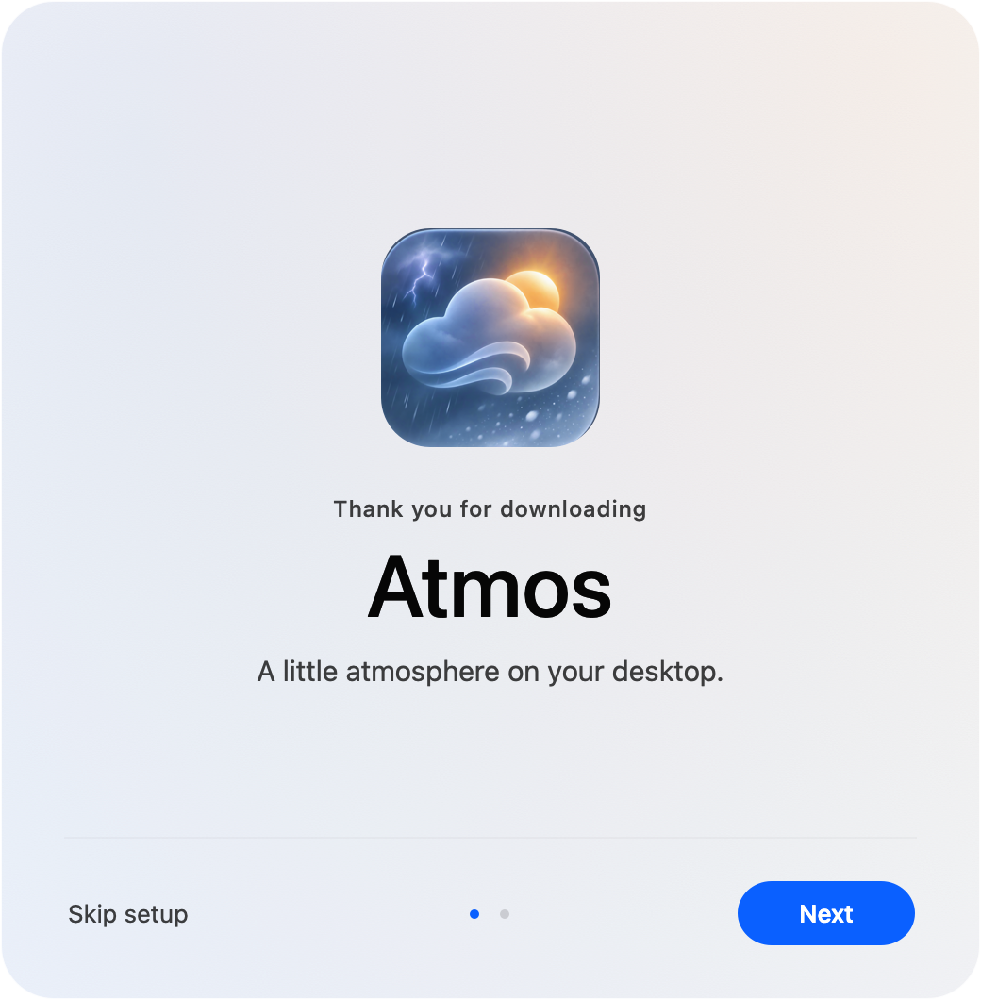

<p align="center">
  
</p>
<h1 align="center">Atmos</h1>
<p align="center">A little atmosphere on your desktop.</p>
<p align="center">
  <a href="https://grobb.dev/projects/atmos">Download for Mac</a> ·
  <a href="https://github.com/scott-g-robb/Atmos/releases">GitHub Releases</a> ·
  <a href="#try-it">See it in motion</a> ·
  <a href="#build">Build from source</a>
</p>
<p align="center">macOS 14+ · Apple silicon &amp; Intel · Free for noncommercial use</p>
<p align="center">Current build: <strong>0.14.2 (68)</strong> · <a href="CHANGELOG.md">What's changed since 0.13.2</a></p>


Atmos lives in your menu bar and brings interactive weather to your Mac. Snow settles
on windows. Rain gathers in reflective puddles. Clouds curl around your cursor.
Choose a scene, or let Live Weather follow the sky outside. Most Cloud Wisps pass behind windows, with occasional foreground billows.

## Try it


*Rendered with the app's Metal renderer against sample windows. The preview is 30 fps;
the app targets your display's native refresh rate, including 120 Hz ProMotion
(up to 60 Hz in Low Power Mode).*

- **Sweep and scatter.** Push through snow and leaves, stir mist, or flick water into splashes.
- **Move your windows.** Drifts follow their ledges. Fast drags send snow, leaves and water falling to the surfaces below.
- **Watch the weather change.** New effects arrive immediately while the old scene naturally melts, dries or dissipates.
- **Keep working.** Controls remain accessible. A window at the top edge covers the weather within its own outline; 70% screen coverage moves the scene behind windows.

| Weather | Seasonal Drift | Wildlife |
| --- | --- | --- |
| Snow · Rain · Drizzle · Storm | Autumn Leaves · Cherry Blossoms | Birds |
| Lightning · Sleet · Hail | Dandelions · Rose Petals | Butterflies |
| Mist · Cloud Wisps · Sunbeams | Maple Seeds · Cottonwood Fluff | Fireflies |

New installs start with Live Weather off and no manual layers selected.
Effects and screen capture stay paused throughout setup, including its menu-bar guide.
If Location is allowed, pressing Next on Permissions starts preparing weather immediately.
Opening the menu-bar icon activates that reading, or continues the same request if it
is still loading. Skip Setup restores an existing user’s selections; a new install stays empty.
Finishing setup enables Live Weather only if Location is allowed.
Choose one item in each section of **Manual Effects**. Click a selected item again to
turn that layer off; weather, drifting material and wildlife work independently.
Petals and seeds share the original leaves' tumbling, cursor interaction, window
accumulation and motion blur. Whole dandelion seed heads burst into windborne seeds
with a soft poof when you sweep through them. Maple seeds autorotate around the stem in individually tilted horizontal planes.
Maple seeds decay naturally and accumulate more lightly than autumn leaves.
Birds arrive in groups of 2–5, usually alone with an occasional second flock and long
quiet gaps. Some groups pass by; others choose one or several spaced window perches,
with varied resting times and mostly related species. Gentle drags carry resting birds,
while a shake makes them fly away.

**Live Weather** continuously shapes cloud cover, rain density and drop motion from
local measurements, with shared gusts and shelter behind windows. Humidity affects
cloud density and evaporation; feels-like temperature affects snow thawing and wildlife.
Rainfall is normalized to mm/h for both providers. Individual drop fall speed is inferred
from rainfall intensity, since weather providers do not measure it.

Cloud cover controls the occupied width across the top of the visible desktop, below
the menu bar. The original soft cloud volumes, lighting and wispy undersides are
preserved. A shared coverage field creates gaps and starts precipitation at the screen top
within covered columns, so it reaches windows near the top of the desktop;
wind then carries the falling drops. Cloud depth and darkness respond continuously
to the rain rate. Clear Scene dissipates the sky and lets it form again gradually.

Mist has a continuous low-lying haze, broad rolling banks and diffuse light scattering
that softens the desktop's contrast. All mist stays behind application windows,
widgets, desktop icons and the Dock, preserving their normal appearance.
Reported visibility adds a restrained haze even when the main condition is partly
cloudy. Visibility from Apple Weather and Open-Meteo is normalized to metres; the
visual density increases gradually as visibility falls. Fog warnings can strengthen
the same layer. This is an artistic display mapping, not a measured fog simulation.
Light haze retains the observed clouds and softened sunbeams; denser fog reduces
wildlife and drifting accents so the desktop stays calm. Visibility is shown in Local
weather details, and reported cloud measurements stay intact.

**Fog Bloom** scatters window-edge, widget, Dock and desktop-icon colours into soft
halos. A clean wallpaper reference separates those objects from the background so
wallpaper detail does not become a competing light source. Dense fog and window
lighting sit behind real windows: macOS clips them to the actual window shape during
minimization, including the curved Genie animation. Widget and icon halos are subtle
and also sit behind the real objects, with no foreground filter or inverted wallpaper
mask. Window-edge colours are cached on the GPU and follow the current window geometry
at display refresh, avoiding delayed-capture flicker. A soft contact halo bridges the
window shadow. Atmos's welcome and update panels stay
clear and above all effects. Bloom uses occasional screenshots while fog is visible,
shares the window texture cache with water, and can be disabled separately in Settings.

Available Apple Weather warnings appear above the current conditions with the issuing
agency's original text and a details link. Active fog warnings add fog while retaining
observed cloud cover and precipitation; future and expired warnings do not drive the
scene. Apple observations and warnings refresh about every five minutes while active.
Failed location or weather requests retry after 1, 2, 3, 5, 15 and then 30 seconds,
turning Live Weather off after 15 failed attempts. No temporary weather scene is
selected. Success or an explicit refresh resets the retry budget.
Location acquisition, retries and timeouts keep working while the menu is open;
the weather card updates as soon as data arrives. Apple gets two bounded attempts,
one second apart, before the labelled Open-Meteo fallback. If neither provider works,
the retry schedule above applies. Cancelled requests cannot replace a newer reading.
Warning availability depends on WeatherKit and the location. Open-Meteo uses the same
cloud and rain system, but its [forecast API](https://open-meteo.com/en/docs) does not
provide official warnings; the menu labels warning data as unavailable.

Seasonal Drift and Wildlife arrive in short spells with quiet intervals, according to
season, hemisphere, wind, rain, warmth and daylight. Windy autumn days can carry leaves
and maple seeds; spring brings blossom and dandelions; warm, dry days can bring
butterflies or birds, and mild summer nights can bring fireflies. Heavy storms suppress
these extras. The menu card shows current measurements and active layers.

Wind uses a fixed compass projection from the reported direction and speed, with no
orientation setup. Window edges split the flow and create shelter and eddies; lighter
seeds follow air more readily than heavier leaves. Leaves and petals float on actual
puddle surfaces, ride ripples and currents, and settle back onto their ledges as water dries.
Snow melts on contact with puddles. Butterflies turn with their flight and stay behind
application windows. Birds have four randomized plumage and silhouette variations.
Dandelions fall as whole seed globes with layered filaments and shaded centres;
sweeping through one releases its individual seeds in a soft burst.

## Install

1. Download the Mac installer from [grobb.dev](https://grobb.dev/projects/atmos) or [GitHub Releases](https://github.com/scott-g-robb/Atmos/releases).
2. Open the `.dmg` and drag **Atmos** into **Applications**.
3. Open Atmos. A short welcome appears for each manually installed copy, including a
   replacement with the same version/build. Only a verified silent automatic relaunch
   bypasses it.
   The panel forms outward from the Atmos icon, followed by the text and controls.
   Choose **Next** to review permissions, or **Skip setup** to restore your previous
   choices. New installs remain empty when setup is skipped.
4. The final screen leads to an arrow below Atmos's menu-bar icon. Open the icon to
   finish setup; the arrow fades away. **Settings → Show Setup…** reopens the guide.

<p align="center"></p>

The installer contains just Atmos and the Applications shortcut, with a drag-to-install
arrow. Quit an older copy before replacing it. To uninstall, quit Atmos and move it
to the Trash.

The included installer is Developer ID signed but **not notarized**. If macOS blocks
it, use **System Settings → Privacy & Security → Open Anyway**. See
[RELEASING.md](RELEASING.md) for Developer ID signing and notarization.

## Make it yours

Atmos's custom dropdown shares the welcome and update screens' soft lighting,
rounded surface and light/dark appearance. A small integrated pointer follows the
menu-bar icon; the panel stays narrow and compact, with no continuous UI animation.
**Live weather** shows local conditions and an **On your desktop** list of the combined
effects, including clouds, haze/fog, seasonal drift and wildlife when present.
The main Live weather tab fits without scrolling. Click the
weather card for the complete measurement set in one place: temperature, feels-like,
wind/direction, gusts, cloud cover, rainfall, humidity and visibility. Unreported values
remain unknown. Warnings, source selection and Refresh Weather are on that page too.
**My atmosphere** shows saved presets
for one-click switching. Each preset's arrow reveals **Edit** and **Delete**. With no
presets, it opens the editor directly. **New atmosphere** starts with no effects,
4 km/h wind, Medium intensity and 0% cloud coverage. Names default to `atmos1`,
`atmos2`, etc. and remain editable at the top.

The editor has four tabs: **Weather**, **Drift**, **Wildlife** and **Advanced**.
Advanced holds intensity, wind and cloud coverage. Selecting weather suggests a
suitable cloud coverage, which you can then adjust. Select an active tile again to
remove that layer. **Save** stays at the bottom right and stores all three layers
and advanced settings. A preset's icon follows Weather, then Drift, then Wildlife.
Empty atmospheres cannot be saved. Presets stay on this Mac.
**Settings → Units** switches all weather displays between Metric (the default:
Celsius, km/h, mm/h, metres/kilometres) and Imperial (Fahrenheit, mph, in/h,
feet/miles). Saved values and simulation calculations keep their original units.
**Settings** holds the full surface, reflection, placement, screenshot, full-screen
and login controls. Manual sliders stay out of Live Weather.
**Check for Updates** stays in a separate footer beside Quit. Clicking outside closes
the dropdown; Escape and keyboard focus remain available. A native loading indicator
appears while Live Weather waits for its first reading; the result eases smoothly
into place inside the fixed dropdown frame. Apple Weather attribution is
scaled consistently and appears once per weather view.

The rounded welcome and permissions screens use native controls, light/dark
appearance and smooth, centred transitions, with reduced-motion alternatives.
Effects return gently after Skip or setup completion, including previously formed clouds. Location
supports Live Weather; Screenshot Access supports desktop reflections and fog bloom;
Open at Login and Automatic Updates are optional. Permissions are requested only when you choose to allow
them or explicitly enable a feature that needs them. Missing permissions never block
the **Next** button.

**Settings → Permissions & Activity** shows granted access and current use for
Screenshot Access, Location Services and Open at Login, with links to macOS settings.
**Settings → Screen Reflections** stops or enables desktop capture without revoking
the macOS permission for water; **Fog Bloom** controls capture for fog independently.
Capture stops when neither visible water nor fog bloom needs it.
**Settings → Water Reflection Source** offers:

| Source | What appears in the water |
| --- | --- |
| **Desktop Screenshots** | Cached desktop and window images follow live geometry; refreshed every 10 seconds and on changes |
| **Window Snapshots** | Window-only water images follow live geometry; refreshed every 10 seconds and on changes |
| **Wallpaper Only** | Wallpaper reflections without capturing other apps |

Water remains interactive with every source. Cursor disturbances refill quickly, and
rain impacts produce visible ripples and energy-scaled splashes on both desktop and
window puddles. Splashes rise mostly upward and carry the rain's wind momentum.
Storm impacts merge into smooth, bounded waves; a lightning strike drives a broad
crown and a pressure-fed jet from the water it hits. Leaving a rain scene dries its puddles
in roughly eight seconds. Switching between water scenes preserves existing water.
Persistent rain can overwhelm the meniscus on a window ledge and spill down its sides.
A conservative shallow-water field keeps window films thin and exchanges volume with
free liquid particles that solve pressure, cohesion and viscosity. Window acceleration
drives flow and separation. The cursor is a solid collider: displaced water flows around
it, and collision momentum can create a splash. Rising puddles lift settled leaves;
splashes carry all floating seasonal material with the local liquid velocity. Water
can flow over a submerged cursor. Fast collisions and shearing liquid produce crisp
white froth that quickly fizzles away. Splashes use fine liquid parcels with smoothed
density contours over neighbouring samples to preserve thin strings and small blobs.
Their soft, asymmetric outlines deform with flow and wobble as they move.
Fresh window releases share the available sample budget so a full particle pool does
not defer the visible splash. Slow cursor hovering does not generate foam. Airborne droplets use the same reflection
source as puddles; they do not independently start screen capture.

## Updates

**Check for Updates…** in the menu bar checks the latest full release at
[scott-g-robb/Atmos](https://github.com/scott-g-robb/Atmos/releases). Releases are
identified by their **Atmos X.X.X** names. If newer, Atmos asks before downloading,
verifying and staging it. All running copies then close before the installed app is
replaced and reopened in the same location. If no
newer version exists, it says **Atmos is up to date**. The prompt and progress panel
share the welcome screens’ design.

Atmos checks for releases about every two hours while running and awake, whether
automatic installation is enabled or not. Below **Check for Updates**, the menu shows
the last-check time and **Up-To-Date**, **Update available** or a failed-check status.
An available update adds a small orange dot beside the menu-bar weather icon.
**Automatic Updates** is an optional setup choice and Settings toggle controlling
installation. When enabled, automatic downloads,
installation and background relaunch are silent. Only that relaunch skips welcome;
a later manual installation always presents setup again.
Update checks stay paused during setup. Automatic installation never opens an administrator
prompt; locations requiring approval wait for a manual update. Manual updates can
request macOS authorization when needed.

Updates verify the release SHA-256 digest, matching bundle/version, CPU architecture
and the existing Apple signing team before replacement. A short-lived helper stages
the new app first, waits for Atmos to close, replaces it atomically and reopens it.
Failed replacement restores the previous copy. There is no persistent update helper.

## Privacy & weather sources

- **Location Services** is requested through setup or an explicit Live Weather/Refresh action. A more accurate fix and neighbourhood-first place names improve local labels. Weather coordinates are rounded to roughly a kilometre; reverse geocoding uses coordinates rounded to roughly 100 metres. Location and weather readings remain in memory.
- **Screenshot Access** permits occasional reduced-resolution screenshots for water reflections and fog bloom. No `SCStream`, video or audio recording is used. IOSurface images stay in GPU-accessible memory and are never saved or uploaded. Atmos windows and off-screen/fully covered windows are excluded. macOS still grants this through its **Screen & System Audio Recording** privacy category and controls any access indicators; screenshot APIs do not provide a promise that no indicator will appear. Stop Sharing/permission revocation is respected until an explicit capture choice resumes it.
- **Automatic · Apple First** tries Apple on every request, retries it once after a second, then clearly labels any Open-Meteo fallback. Transient fallback checks Apple again after 30 seconds, backing off to five minutes. Selecting Apple also permits this labelled fallback after its retry; selecting Open-Meteo requests only that provider. Attribution-image failures never discard a successful weather reading.

The distributed app uses native WeatherKit authorization for all Macs; users do not
need personal keys or a developer account. Source builds need a matching WeatherKit
profile/signing identity, or optional personal credentials in Keychain. Open-Meteo
works without an API key. Atmos uses the
supported Apple weather service; it does not read the Weather app's private files.
See [weather setup](RELEASING.md#apple-weather).

If Screenshot Access looks enabled in macOS but unavailable in Atmos, use
**Settings → Permissions & Activity → Recheck Screenshot Access**. This explicitly
verifies access with ScreenCaptureKit without starting a capture stream. macOS can
require a fresh grant or relaunch after a signing-identity change; **Restart Atmos…**
is available beside Recheck. Stop Sharing remains respected.

## Built for macOS

Swift and AppKit handle the menu, displays and system integration. Metal renders the
effects and simulates cloud flow; an allocation-free Rust core handles wind shelter,
particles, pile transport, cursor/water interactions, buoyancy and wildlife motion. Metal reconstructs liquid contours directly in GPU buffers, with a Rust
fallback; splash merging uses fixed storage and conserves mass and momentum.
The welcome entrance plays the supplied introduction audio once. Silent background
updates and launches that do not show the welcome remain quiet.

[Performance notes](docs/PERFORMANCE.md) describe the measured before/after results
and what remains unverified. Buffers and pipelines are reused, and desktop capture adapts independently
of animation. Visible animations target each display's native rate; macOS may lower
the physical refresh rate for power or thermal reasons.

Weather refresh resumes after wake and network reconnection, with short retries while
services recover. By default, animation and capture pause while the display is asleep, locked or covered
by a full-screen app. Reduce Motion is respected. Energy use varies with the scene,
resolution, display rate and reflection source; no fixed CPU/GPU percentage is promised.

## Build

Requires Xcode, its command-line tools, and [Rust](https://rustup.rs/).

```sh
./test.sh             # Rust, Swift and Metal regression tests
./build.sh            # Universal build/Atmos.app
./make-installer.sh   # Verified dist/Atmos-<version>.dmg
./scripts/package-source.sh # Source ZIP without build products or credentials
./install.command     # Build, install into ~/Applications and launch
```

Builds are ad-hoc signed unless a signing identity is configured. Rust is linked
statically; users need no toolchain or runtime dependencies. Metal tests skip when
no compatible GPU is available.

```
Sources/Atmos/
  App/          Lifecycle, preferences and power management
  Desktop/      Displays, window tracking and reflections
  Rendering/    Metal renderers, shaders and GPU cloud flow
  Simulation/   Weather, water, snow and seasonal physics
  UI/           Native menu controls and welcome window
  Weather/      Location, providers and WeatherKit credentials
Sources/CWeatherCore/  C interface and ABI checks
weather-core/          Rust simulation core
Tests/                 Interaction, physics and rendering regressions
site/                  Static project page and interactive snow demo
```

See [RELEASING.md](RELEASING.md) for public releases and signing. Build products,
profiling output and local signing material are excluded from source control.

## Credits & license

Atmos grew from [Snowhush](https://github.com/mbezruchko/Snowhush) by Mykhailo Bezruchko.
The original copyright notice and [PolyForm Noncommercial 1.0.0 license](LICENSE) are
retained; see [NOTICE.md](NOTICE.md). This is source-available software for
noncommercial use.

Weather data: Apple Weather, with attribution in the app, and
[Open-Meteo](https://open-meteo.com/) under [CC BY 4.0](https://creativecommons.org/licenses/by/4.0/).
